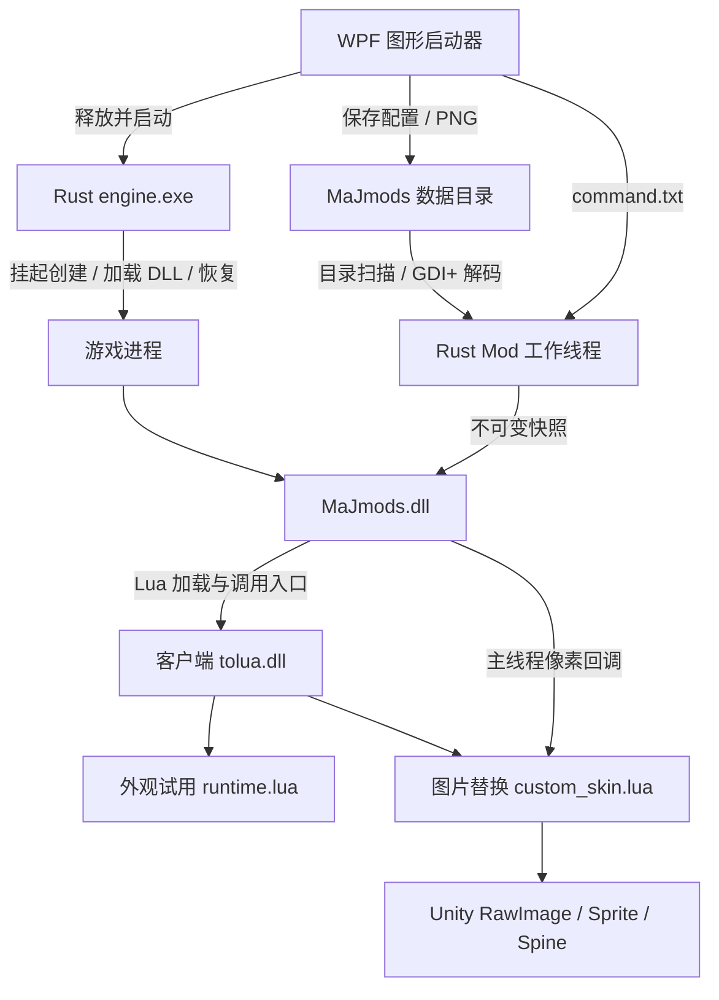
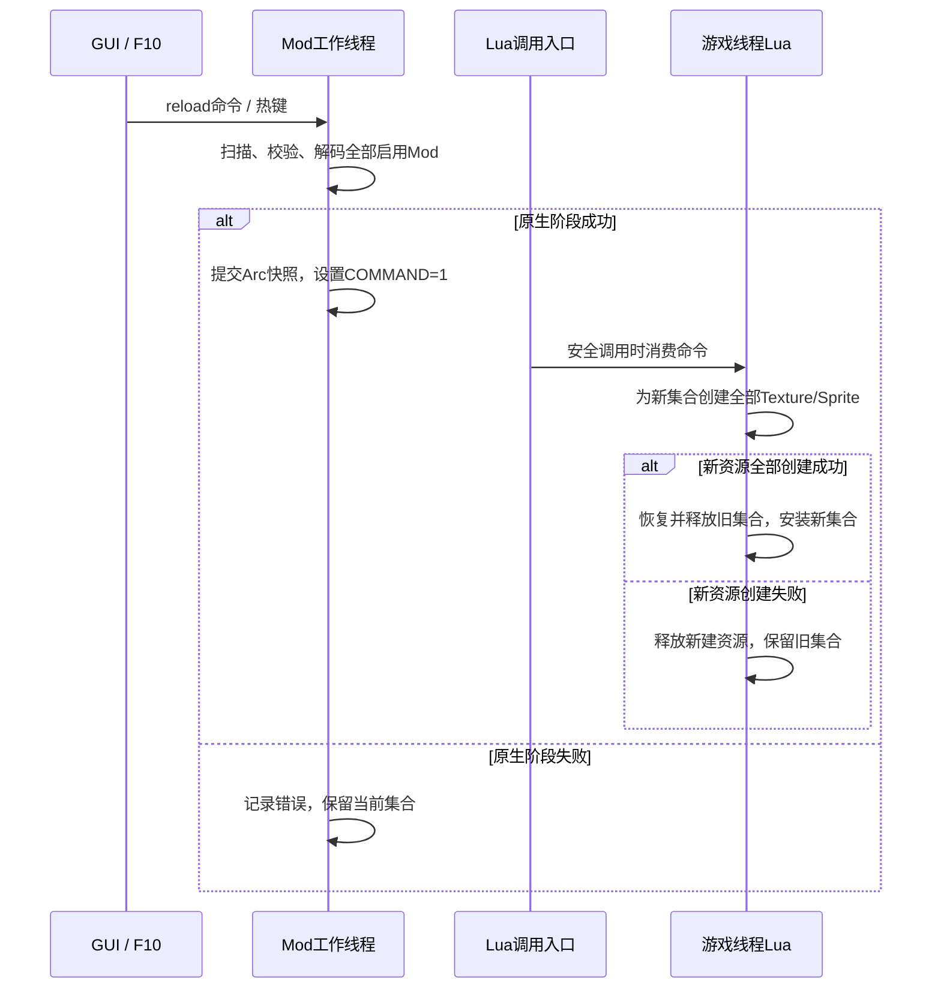

# Majsoul-modLauncher 工程实现说明

> 适用版本：0.6.9。编写日期：2026-11-20。以当前仓库源码为依据，供二次开发、客户端升级适配和问题排查使用。
>
> 用户安装与操作见 [使用说明](LocalPreview/README.txt)，素材组织见 [Mod 适配指南](MOD适配指南.md)，动态图集制作见 [动态皮肤模组制作指南](动态皮肤模组制作指南.md)。

## 1. 工程目标与运行边界

本项目面向 Windows x86 雀魂 Unity 客户端，将本地外观试用与图片 Mod 整合进同一个启动器。它由 WPF 图形界面、Rust 原生启动组件、注入 DLL 和 Lua 运行时组成。

工程包含两条相互配合的功能链路：

- **外观试用链路**：扩展本机可选的角色、皮肤及部分装饰数据，在本地处理对应的外观选择请求，按账号保存角色和皮肤选择。
- **素材替换链路**：按角色 ID 与皮肤 ID 选择 Mod，将 PNG 转换为 Unity 纹理，替换静态立绘、动态皮肤图集和大小头像，支持运行中重载与恢复。

角色试用、友人房和对局中的本人外观基于本地展示数据实现；牌谱与观战的实际渲染保留原有路径。其他账号的立绘不会因本人选择而被替换。头像按对应皮肤 ID 匹配，因此同一皮肤通过不同头像入口加载时也会使用该皮肤的本机替换图。

现有适配依赖客户端 Lua 函数名、参数结构、Unity Lua 绑定以及 Spine 渲染组件接口。客户端更新后，需要重新验证这些契约。

## 2. 总体架构



### 2.1 分层职责

| 层次 | 实现 | 核心职责 |
| --- | --- | --- |
| 图形界面 | [Launcher.cs](LocalPreview/gui/Launcher.cs)、[MainWindow.xaml](LocalPreview/gui/MainWindow.xaml) | 角色目录、搜索、Mod 编辑、启动控制、进度、主题与偏好保存 |
| 原生启动 | [launcher.rs](LocalPreview/src/launcher.rs)、[injection.rs](LocalPreview/src/injection.rs)、[steam.rs](LocalPreview/src/steam.rs) | 游戏路径校验、旧版迁移、Steam 环境、进程创建、DLL 加载与阶段确认 |
| DLL 接入 | [lib.rs](LocalPreview/src/lib.rs)、[hooks.rs](LocalPreview/src/hooks.rs)、[pe.rs](LocalPreview/src/pe.rs) | DLL 初始化、Lua 入口接管、源码转换、调用栈恢复 |
| 外观试用 | [runtime.lua](LocalPreview/data/runtime.lua)、[adapter.tsv](LocalPreview/data/adapter.tsv)、[catalog.rs](LocalPreview/src/catalog.rs) | 物品目录扩展、请求分流、本人展示数据与账号级选择 |
| 图片 Mod | [custom_skin.rs](LocalPreview/src/custom_skin.rs)、[custom_skin.lua](LocalPreview/data/custom_skin.lua) | 目录扫描、图片解码、事务重载、场景收集、渲染绑定和资源释放 |
| 验证 | [check.rs](LocalPreview/src/bin/check.rs)、[tests](LocalPreview/tests)、[verify.ps1](LocalPreview/verify.ps1) | 单元测试、真实客户端 Lua 语法与函数验证、原生钩子及失败回退 |

### 2.2 进程与线程

WPF EXE 在自己的进程中运行。它将内嵌的 Rust 启动程序释放为后台进程；原生 DLL 加载到游戏进程后，即使图形界面和后台启动进程退出，Mod 仍随游戏运行。

游戏进程内，文件扫描、PNG 解码、热键和命令文件轮询由 Mod 工作线程处理。Lua 和 Unity 对象操作借助游戏自身 Lua 调用入口执行，避免从文件工作线程直接创建或销毁 Unity 对象。

## 3. 目录与构建产物

```text
MajsoulMax-Windows/
├─ README.md                     项目入口
├─ 工程实现说明.md               本文
├─ MOD适配指南.md                普通 Mod 制作与配置
├─ 动态皮肤模组制作指南.md       图集制作与绑定说明
├─ LocalPreview/
│  ├─ Cargo.toml                 Rust 包、库和二进制定义
│  ├─ .cargo/config.toml         x86 静态 CRT 配置
│  ├─ src/                       原生实现
│  ├─ data/                      编译时内置默认数据及 Lua
│  ├─ gui/                       WPF 实现、内嵌头像资料、构建脚本
│  ├─ tests/                     Lua 环境替身与功能断言
│  ├─ build.ps1                  正式构建入口
│  ├─ verify.ps1                 离线验证入口
│  ├─ Majsoul-modLauncher.exe    当前可运行图形启动器
│  ├─ MaJmods.dll                与启动器配套的原生 DLL
│  ├─ MaJmods.ini                已选择的游戏路径
│  ├─ MaJmods/                   运行数据与用户 Mod
│  └─ target/                    构建、验证及本地备份产物
└─ tools/                        客户端 Lua 分析与辅助工具
```

Rust 库的内部名称仍为 `version`，生成的 DLL 名称为 `version.dll`；正式打包阶段将其复制为 `MaJmods.dll`。原生启动二进制内部仍名为 `MJLocalPreview.exe`，WPF 将它作为 `MJ.Engine` 资源嵌入，运行时释放为 `MaJmods/launcher/engine.exe`。这些旧内部名称属于构建和兼容约定。

## 4. 图形启动器

### 4.1 资源与界面

WPF 使用系统 .NET Framework 4.x 的编译器和程序集构建，目标平台为 x86。窗口 XAML、图标、角色与皮肤资料压缩包、原生启动组件全部作为程序集资源嵌入，不依赖 WebView 或 NuGet。

[资源加载实现](LocalPreview/gui/Launcher.cs#L105) 从压缩包读取角色、皮肤 TSV 及头像 PNG。角色头像按 ID 缓存，并以 192 像素解码显示。内置头像服务于启动器角色目录；游戏内头像由各 Mod 的大小头像文件控制。

### 4.2 配置写入

[Files.Atomic](LocalPreview/gui/Launcher.cs#L84) 先在目标目录创建唯一临时文件，写入并刷新，然后调用 `MoveFileEx` 替换目标文件。文本按无 BOM 的 UTF-8 写入。路径检查会检查文件及父目录的重解析点，避免沿目录链接写入其他位置。

单个 Mod 开关仅修改 `enabled` 行，保留其他配置与注释。启用相同角色和皮肤组合的新 Mod 时，界面先停用已启用的同组合 Mod。批量启用为每个组合选择一个候选，逐项写入并报告失败数量；它不提供跨全部配置文件的事务回滚。原生重载阶段会再次完整校验。

“更换头像”固定写入 `smallhead.png` 或 `bighead.png`。保存配置或图片后，若当前游戏已连接，界面写入 `reload` 命令；恢复按钮写入 `close`。该命令文件是单槽控制入口，多次快速写入可能合并为最终状态，不承担消息队列功能。

### 4.3 启动状态

[StartGame](LocalPreview/gui/Launcher.cs#L829) 校验游戏路径和配套 DLL，按资源内容刷新后台启动组件，以 `--headless --root ... --game ... --close-after 0` 运行。后台线程异步读取标准输出和错误输出，通过 Dispatcher 更新 WPF 进度，结果写入 `MaJmods/launcher/launch.log`。

启动成功既要求原生组件正常退出，也要求图形界面确认当前游戏已连接。默认在成功后倒计时 5 秒关闭窗口。主题与自动关闭偏好保存在 `MaJmods/launcher/ui.ini`，游戏路径保存在工具根目录的 `MaJmods.ini`。

## 5. 游戏启动与 DLL 生命周期

### 5.1 启动顺序

1. 定位游戏 EXE、校验 PE 架构及配套 DLL，处理适用的旧版安装记录。
2. 对 Steam 版解析对应的安装记录，核对安装目录及 App ID，为子进程准备 `SteamAppId`、`SteamGameId`。
3. 以挂起方式创建游戏进程，准备进程 ID 对应的阶段事件。
4. 将工具目录中的 DLL 加载到目标进程，等待 DLL 初始化完成。
5. 恢复游戏主线程，等待 Lua 入口接管信号。
6. 确认目标进程运行状态，向界面返回结果。Steam 版额外等待 8 秒，检查本次创建的游戏进程是否仍在运行；源码未直接检测 Steam 登录状态，也不跟随重新拉起的新进程。

DLL 加载线程等待上限为 30 秒，`ready` 阶段为 10 秒；恢复游戏后等待 `hooks` 最多 25 秒。恢复主线程前失败会终止本次创建的进程；恢复后未等到钩子事件时，保留游戏运行并提示未确认。

正常启动使用显式注入，不要求在游戏安装目录中新放置代理 DLL。当前流程要求游戏尚未运行；它不会直接给一个已经进入游戏的进程补装完整启动链路。

### 5.2 阶段事件

原生接入使用 `Local\MJLocalPreview.<PID>.<stage>` 命名事件区分阶段。`ready` 表示初始化和加载通知准备完成，`hooks` 表示三个 Lua 加载导出均已替换且满足接管前提。事件确认的是加载入口安装状态，不证明适配规则已经命中、改写代码已经执行或某个立绘组件已经显示。

DLL 初始化入口与具体启动操作分离，由工作线程执行数据准备和钩子初始化。Lua 库可能晚于 DLL 注入才出现，因此接入逻辑同时使用模块加载通知和等待检查。

### 5.3 兼容迁移

旧数据目录 `MJLocalPreview` 在新目录尚不存在时迁移为 `MaJmods`；旧游戏路径配置也有对应迁移。历史自动加载 DLL 的迁移按安装记录和哈希判断，避免把未知文件当作本项目旧文件处理。兼容代码仍保留在 [launcher.rs](LocalPreview/src/launcher.rs) 与 [proxies.rs](LocalPreview/src/proxies.rs)。

## 6. Lua 接管与外观试用

### 6.1 接管点与失败回退

[hooks.rs](LocalPreview/src/hooks.rs) 读取外部配置、目录和适配表后，通过 [pe.rs](LocalPreview/src/pe.rs) 修改 `tolua.dll` 的导出地址表（EAT），接管 `luaL_loadbuffer`、`luaL_loadbufferx`、`tolua_loadbuffer`。目标函数机器码保持原样；已经缓存的函数指针和模块内部直接调用不会因此自动改道。

处理对象为非空 UTF-8 文本 chunk，Lua 字节码跳过。源码转换后先交给客户端自己的 Lua 编译器，若补丁编译失败，恢复原始源码加载及调用栈状态；已执行 Lua 的业务副作用不属于这个回退机制。线程局部重入标志避免补丁编译过程再次进入自身。

安装在进程内只尝试一次。三个加载导出未全部安装成功时，已接入的加载入口保持原输入转发；没有完整的 EAT 撤销、自动重试或运行中 DLL 卸载流程。`lua_pcall` 作为独立附加钩子，安装结果没有计入 `hooks` 事件判定，因此排查图片更新时还应检查实际调用与 Mod 日志。

`mode = preview` 启用接管；`dump = true` 用于保存命中模块的诊断数据。初始化配置在 DLL 启动时读取，修改适配表或外观试用脚本后应重启游戏验证。

### 6.2 函数体改写

[transform.rs](LocalPreview/src/transform.rs) 实现一个面向 Lua 函数声明的轻量词法扫描器：跳过字符串、单行和长注释，识别带点号或冒号的限定函数名，把补丁插入参数列表结束后的函数体开头。

适配表每行包含三列：规则键、函数名、Lua 代码，以 TAB 分隔。`{{1}}`、`{{2}}` 等占位符绑定实际源码中的形参名称，使适配不依赖混淆后的局部参数名。

它不是完整 Lua AST 或任意程序变换器。相同函数出现多个定义、参数占位符无法绑定时会返回错误；未命中的模块保持原文。补丁头标记用于避免重复改写。当前表包含 17 个适配点，覆盖请求发送、角色数据、背包、选择页、房间和对局展示。

网络发送规则是初始化前提。只有请求入口所在模块设置 `guard_ready` 后，外观试用状态才启用，以保证本地选择与请求分流同步建立。

### 6.3 目录与展示数据

[catalog.rs](LocalPreview/src/catalog.rs) 解析限定的 YAML 数字列表子集，接受角色、皮肤、称号、物品、加载图等指定分区，校验并去重 ID，生成 Lua 表替换脚本的 `@CATALOG@`。它不执行通用 YAML 标签或嵌入代码。

[runtime.lua](LocalPreview/data/runtime.lua) 将清单与客户端 Excel 数据交叉核对，扩展本机展示列表。对协议对象按 descriptor 字段复制，对数组单独复制，避免原地修改收到的协议数据；角色和皮肤也按实际角色归属校验。

### 6.4 请求分流与账号持久化

`M.request` 只处理 `Lobby` 模块的明确方法集合，包括角色/皮肤选择、装饰选择、称号、加载图和部分本地配置。命中后更新本机状态并调用本地回调，其他方法继续走原始发送入口。`fetchTitleList` 包装返回回调以合并本地称号。试用角色的送礼和升级入口单独拦截。

角色及皮肤选择写入 Unity `PlayerPrefs`，键为 `MJLocalPreview.appearance.v1.<account_id>`。保存值使用版本号和数字 ID 串，不把保存内容当 Lua 执行。账号切换会清空会话选择并加载对应账号数据。装饰组合、称号等其他会话变量没有因此全部获得跨重启持久化。

房间、实际对局展示复制并替换本人对应条目，保留其他座位。预加载路径可以加载真实与试用资源的并集；实际替换仍由实时对局模式控制。

## 7. Mod 扫描、配置与像素协议

### 7.1 目录契约

```text
MaJmods/mods/角色分组/Mod名称/
├─ mod.ini
├─ custom.png                   或 image 指定的相对 PNG 路径
├─ smallhead.png                可选；优先于 小头像.png
├─ bighead.png                  可选；优先于 大头像.png
└─ spine/
   └─ layer1/
      └─ 原图集名.png
```

扫描固定遍历角色分组与 Mod 文件夹两级目录，按配置 ID 匹配，文件夹名称只作标签。最小配置示例：

```ini
enabled = 1
character_id = 200017
skin_id = 401701
image = custom.png
```

`character`、`skin` 为旧字段别名，新旧字段同时出现会报错。`skin_id = 0` 或省略表示角色通用配置；指定皮肤的配置优先于角色通用配置。相同 `(character_id, skin_id)` 重复启用时整次扫描失败。

### 7.2 校验与预算

[scan](LocalPreview/src/custom_skin.rs#L70) 的主要约束如下：

| 项目 | 当前规则 |
| --- | --- |
| 配置文本 | UTF-8，支持 BOM；单文件最多 64 KiB；重复键报错 |
| 开关和 ID | `enabled` 为 0/1，默认 1；角色 ID 为正整数 |
| 主图片 | 必须存在，路径限定在 Mod 内部的相对 PNG 路径 |
| 单图尺寸 | 宽 1–4096，高 1–8192 |
| 总解码预算 | 所有启用 Mod 的主图、动态图集和头像合计 1024 MiB；计入每张图片的 8 字节尺寸头 |
| 动态图集 | `layer1` 至 `layer32`；每层一张 PNG；文件名限定 ASCII 字母、数字、下划线和连字符 |
| 布局项 | `lobby/room/match/ending/dorm/dorm_preview` 的 `_x`、`_y`、`_height` |
| 布局数值 | 有限数值，绝对值不超过 100000；高度必须为正 |

扫描只加载启用项。任一启用 Mod 无效时，新的集合不提交。英文头像文件优先；若优先文件损坏，会返回错误，保留旧集合，而非自动降级到中文文件。

GUI 另有 PNG 签名、文件大小和尺寸预检，原生解码仍是实际加载判定。GUI 的友好提示不能替代原生完整校验。

### 7.3 原生与 Lua 的数据边界

GDI+ 通过 Unicode 路径读取 PNG，原生端将像素转换为自底向上排列的 RGBA。每张图片形成如下内存块：

```text
偏移 0：width，u32，小端
偏移 4：height，u32，小端
偏移 8：width × height × 4 字节 RGBA
```

清单的索引按每个 Mod 的主图、按层排序的动态图集、小头像、大头像依次分配。Lua 通过 `_MJCustomPixels(index)` 获取对应块，检查尺寸及长度后创建 `Texture2D`，头像额外创建 `Sprite`。中文路径只由原生层处理；Lua 不直接打开素材路径，也不生成解码后的磁盘缓存。

## 8. 热重载、并发与资源释放



原生侧用 `Mutex<Option<Arc<Vec<Mod>>>>` 保存不可变解码快照，用原子命令值连接工作线程和 Lua 执行入口。像素回调通过线程局部 `ACTIVE` 持有本次清单对应的快照，避免读取期间被其他重载释放。

工作线程每 20 毫秒检查热键及命令文件；键盘热键限定游戏进程处于前台。`lua_pcall` 钩子先调用原函数，仅在成功返回时调用 `pump`，沿用本次调用的 Lua state 和线程；代码没有额外校验 Unity 主线程 ID，也没有按 Lua state 分立命令队列。它按全局 80 毫秒节流，依赖游戏持续进行 Lua 调用，并非独立渲染帧定时器。执行后恢复原 Lua 栈顶，登录及组件尚未准备好时，重载命令可以重新排队。

F11 或 `close` 将当前图片集合关闭，恢复记录的组件状态并释放纹理。F10 或 `reload` 再次建立新集合。这里恢复的是图片 Mod；外观试用运行时、已保存的 Mod 配置与角色选择继续存在。

1024 MiB 是原生解码集合上限。实际进程还会持有 Unity CPU/GPU 纹理、Lua 字符串、旧集合和新集合；重载峰值可能明显更高。所有组件均运行于 32 位进程地址空间，预算上限不代表实际环境必然能加载到该数值。

## 9. 游戏内渲染实现

### 9.1 候选收集与生命周期

[候选收集](LocalPreview/data/custom_skin.lua#L199) 按大厅、宿舍、服饰预览、友人房、本人个人名片、实际对局和结算逐处查找活跃组件，并按角色及皮肤匹配 Mod。记录同时绑定组件、`targetVersion`、场景和所选 Mod；组件复用、换皮肤、关闭窗口、匹配范围变化时恢复旧记录并重新建立。

个人名片是多实例 UI，不能按其他页面的单例取法处理。0.6.9 从 `UIMgr.Inst.uiInstanceDict[UI_PlayerInfo.className]` 枚举窗口，仅收集 `accountId` 等于当前账号的静态与动态立绘组件。当前没有 `profile_x/y/height` 配置项，个人名片沿用原组件几何。

### 9.2 静态立绘

静态路径创建同父级的 `RawImage`，关闭射线拦截，复制原组件的 anchors、pivot、缩放、旋转、位置和颜色；按原图高度及自定义图片宽高比计算尺寸，并考虑 stretch anchors。父级保持一致，使原遮罩、裁切及轮播缩放继续生效。

原始图像及相关显示对象的激活状态被记录后隐藏。恢复时检查组件版本，再还原对应对象并销毁覆盖对象，避免旧记录干预已复用的新组件。可选布局值在原布局上增加偏移或覆盖高度。

### 9.3 动态皮肤

动态路径复用客户端原有骨骼、动画和网格，替换图集纹理。匹配优先使用原纹理名称及尺寸，`layerN` 用于同名候选消歧；素材提取层号不要求等同运行时渲染层序号。

渲染覆盖包含 `SkeletonGraphic.OverrideTexture`，以及多 CanvasRenderer 路径的 `CustomTextureOverride` 字典。应用后调用 `SetMaterialDirty`。恢复时保留原字典项及原覆盖值，仅在当前值仍属于本 Mod 时还原，避免覆盖其他组件的新状态。

缺少匹配图集时保留原动态显示。主 PNG 仍供静态展示路径使用；现有实现不替换骨骼、动画文件、3D 模型或全部特效渲染器。

### 9.4 首帧与隐藏事件

包装 `UI_Character_Skin.SetSkin` 的加载完成回调，在返回 Unity 渲染前应用当前集合；包装 `SetActive`、`Clear`、`ClearWithoutCImage` 处理显隐与清理。回调始终查找当前 `MJCustomPortrait`，避免 F10 后继续捕获旧纹理。80 毫秒更新用于布局跟随和遗漏组件补查。

### 9.5 大小头像

头像路径包装 `Tools.SetHeadImg` 和 `ImageMgr.SetTextureAsync`，识别大小头像与皮肤 ID，保留原有位置参数、默认图参数、回调参数和返回行为。在异步加载完成后再次绑定自定义 Sprite，避免被原图覆盖。

头像目标使用弱键表登记，配合组件复用恢复。角色选择页存在头像路径缓存，已有卡片可能不会再次调用加载函数，因此额外遍历其 `map_go_headpath`，补登记并更新已显示的头像。

## 10. 默认文件与升级规则

| 数据类型 | 初始化及更新规则 | 修改后生效方式 |
| --- | --- | --- |
| 外观试用脚本、适配表、目录、模式配置 | [bundled.rs](LocalPreview/src/bundled.rs) 只补齐缺失文件，已有外部文件保留 | 重启游戏 |
| 图片替换脚本 | 原生 `prepare` 在初始化时将内嵌版本写入运行数据目录 | 会话中外部修改可随 F10 读取；下次初始化会被内嵌版本覆盖 |
| Mod 图片与配置 | 扫描启用集合，不覆盖用户已有 Mod | F10 或 GUI 重载 |
| 游戏路径与 GUI 偏好 | 由界面和原生启动流程维护 | 按对应设置保存/下次启动读取 |
| EXE / DLL | 构建或发行包更新 | 分别退出启动器、游戏后更换 |

这一区别对升级很重要：重新编译内置外观试用脚本，不会自动覆盖运行目录中已经存在的旧外部脚本；而图片替换脚本在 DLL 初始化时会同步内嵌版本。

只有整个 Mod 根目录尚不存在时，程序才进行旧 `CustomSkins` 导入或默认示例初始化。刻意保留的空 Mod 目录不会被重新填充。

## 11. 构建与验证

### 11.1 开发环境

需要 Windows、Rust、`i686-pc-windows-msvc` 标准库、MSVC x86 工具链、Windows SDK 和系统 .NET Framework 4.x。Rust 工程没有第三方 crate，使用 Windows 系统 API；[目标配置](LocalPreview/.cargo/config.toml)启用静态 CRT。

下列命令从仓库根目录在 PowerShell 执行：

```powershell
# 正式构建，复制 EXE 与 DLL 到 LocalPreview
.\LocalPreview\build.ps1

# 仅生成暂存产物，避免覆盖当前运行文件
.\LocalPreview\gui\build.ps1 -StageOnly

# 完整离线验证；按实际客户端位置传参
.\LocalPreview\verify.ps1 `
  -Tolua 'E:\MajSoul\GameClient\Jantama_MahjongSoul_Data\Plugins\x86\tolua.dll' `
  -Dump 'E:\MajSoul\GameClient\MajsoulPreview\dump'

# WPF 自检，报告放在构建输出目录
.\LocalPreview\Majsoul-modLauncher.exe --self-test `
  '.\LocalPreview\target\gui-selftest.txt'
```

[正式构建脚本](LocalPreview/gui/build.ps1)先编译原生启动二进制和 DLL，再用系统 C# 编译器构建 WPF，并将原生启动程序、资源及 XAML 嵌入 EXE。仅运行验证脚本不会替代完整 GUI 发行构建。

### 11.2 离线验证层次

1. Rust 单元测试覆盖配置解析、目录及路径校验、Mod 冲突、图片与头像读取、Steam 信息解析、Lua 转换等。
2. 验证程序加载实际客户端的 `tolua.dll`，遍历 dump 的 `index.tsv` 所列模块，编译改写结果，要求每条适配规则恰好命中一次。
3. 从客户端源码抽取实际函数体，结合测试环境执行功能断言，验证本地选择、账号隔离、持久化和请求处理。
4. Lua 图片断言验证静态布局、动态图集、大小头像、个人名片多实例、异步加载、F10/F11 及组件复用。
5. 加载原生 DLL 检查实际钩子；在私有测试副本中故意加入畸形 Lua，验证原始模块和 Lua 栈回退，再恢复该测试副本。

0.6.9 的既有验证记录为 **20 项 Rust 单元测试、957 个索引模块、17 个唯一适配点**，并通过 Lua 功能断言和 GUI 自检。这些数字是对应版本和客户端 dump 的结果，客户端更新后应重新生成验证结果。

本文编写仅修改文档，没有重新执行完整构建或游戏验收。离线验证与实机视觉验收相互补充；建议发布前分别检查大厅、宿舍、服饰预览、本人/他人名片、友人房、实际对局、结算、大小头像及重载恢复。

## 12. 日志与排障

| 现象 | 优先证据 | 检查重点 |
| --- | --- | --- |
| 点击启动后失败 | `MaJmods/launcher/launch.log` | 游戏路径、x86 架构、配套 DLL、已运行进程、Steam 环境 |
| DLL 已加载但试用未就绪 | `MaJmods/preview-<PID>.log` | 初始化配置、Lua 库发现、规则命中、补丁编译及回退 |
| F10 后仍显示旧素材 | `MaJmods/custom-skin-<PID>.log` | 是否有扫描错误，启用数量及头像数量，命令是否应用 |
| Mod 已加载但某页面未替换 | Lua `last_error`、该页面组件结构 | 皮肤 ID、本人账号判定、候选收集、组件可见及加载状态 |
| 动态皮肤部分未替换 | 图集名称、尺寸与运行时渲染层 | 图集页匹配、单/多 CanvasRenderer 路径、特效组件 |
| 更新代码后仍运行旧逻辑 | DLL 版本、外部脚本与启动日志 | 是否重启游戏，是否保留了旧外部脚本，是否使用同目录配套产物 |

Mod 日志中的 `Loaded N enabled mods (X small avatars, Y large avatars)` 表示原生扫描完成；`mod command 1 applied` 表示 Lua 重载已执行。应结合对应 PID、页面和组件观察结果，避免将一次扫描成功直接等同于所有场景渲染验收成功。

## 13. 维护与扩展建议

- **新增物品**：更新目录清单，并先确认客户端 Excel 数据及原生资源存在。ID 出现在清单中不代表客户端包含该资源。
- **新增页面**：扩展 Lua 候选收集，明确单例或多实例、本人身份来源、加载完成时机、清理与复用方式。新增布局项须同步原生配置白名单。
- **客户端函数变更**：重新采集 dump，更新适配表，以每条规则唯一命中和实际函数断言验证；涉及扫描语法时同时修改转换器测试。
- **新增头像入口**：核对实际加载函数、路径和回调语义，补充异步完成、缓存命中及池化控件测试。
- **动态图集扩展**：先确认纹理名称、尺寸及渲染组件。多页图集、骨骼替换或特效替换需要新的数据契约，不能仅增加一个目录名实现。
- **更新启动器资料**：使用 [prepare_assets.py](LocalPreview/gui/prepare_assets.py) 重新生成内嵌资料；开发时需要 Pillow，运行时不依赖原始素材目录。

[tools](tools) 中保留客户端分析与辅助脚本。其中 [mods.py](tools/mods.py#L27) 仍采用历史 128 MiB 自身预算，不能用它推断当前 DLL 的 1024 MiB 预算，也不应将它视为原生扫描器的等价实现。

构建和验证输出可再生成，但 `target` 下若另行存放回滚备份或人工报告，需要按用途保留。用户 Mod、待处理素材、原始素材包和运行配置属于独立数据，清理构建缓存时应分别核查。
